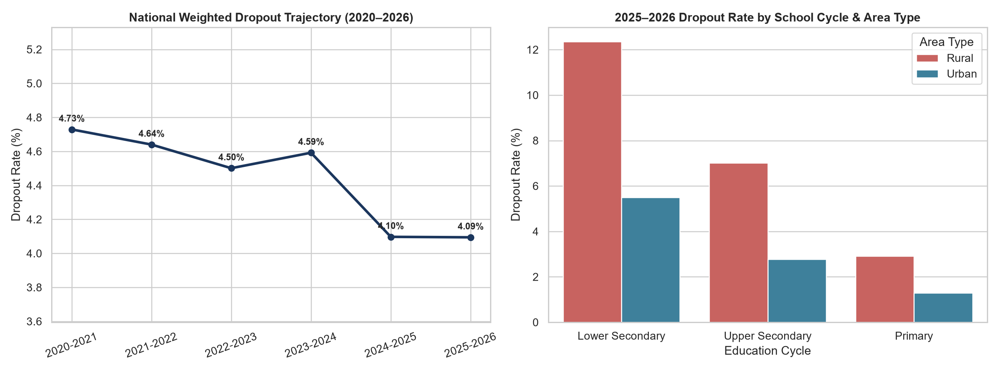
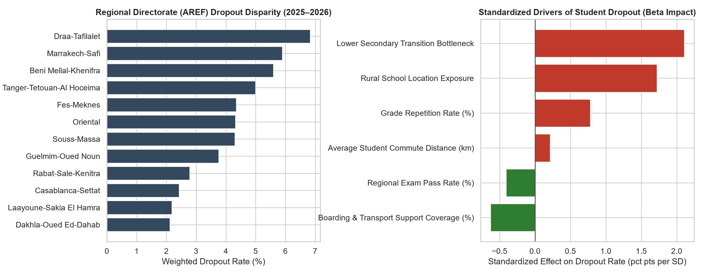

# National Education Performance & Retention Analytics

Longitudinal data analytics and business intelligence solution built with **Python (`pandas`, `NumPy`, `scikit-learn`)**, **SQL (Star Schema + Window Functions)**, **Microsoft Excel (`XlsxWriter`)**, and **Power BI (DAX)** to evaluate student retention, regional directorate disparities, and structural drivers of early school leaving across 12 regional directorates (2020–2026).

## Executive Visual Dashboards





## Key Analytical Findings & Architecture
- **Star Schema Data Warehouse (`sql/01_star_schema.sql`, `sql/02_analytical_kpis.sql`):** Models 432 longitudinal regional-cycle-area cohorts across `dim_directorate`, `dim_academic_year`, `dim_school_cycle`, and `fact_cohort_retention`, using SQL window functions (`LAG`, `RANK`) to compute year-over-year dropout deltas and regional priority rankings.
- **Structural Bottleneck & Equity Diagnostics:** Identifies the **Lower Secondary transition** and **Rural school exposure** as the primary drivers of student dropout, alongside grade repetition rates and commute distance.
- **Automated Executive Excel Report (`dashboards/excel/education_retention_executive_report.xlsx`):** Generates a formatted 4-tab stakeholder workbook (`Executive_Summary`, `Regional_Disparity`, `Cycle_Urban_Rural`, `Dropout_Drivers`) with native Excel charts.
- **Power BI Semantic Layer (`dashboards/powerbi/`):** Includes pre-modeled Star Schema tables and production DAX measures (`measures.dax`) for Weighted Dropout Rate, Cohort Retention Rate, YoY Dropout Delta, Reintegration Recovery Rate, and Regional Disparity Index.

## Quickstart
```powershell
python -m venv .venv
.\.venv\Scripts\Activate.ps1
pip install -r requirements.txt
python -m src.generate_dataset
python -m src.build_reports
pytest
```
